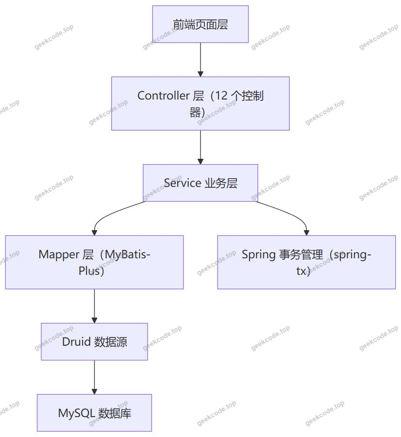
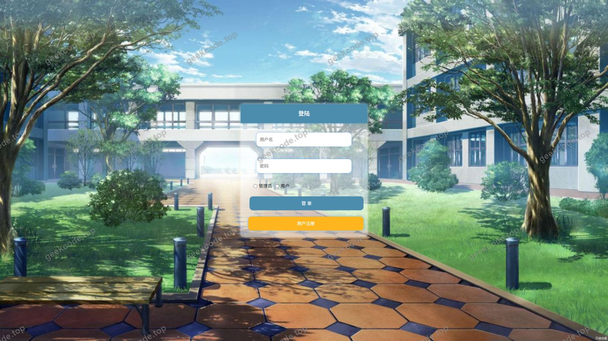
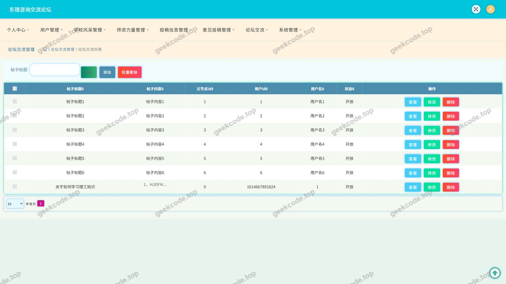
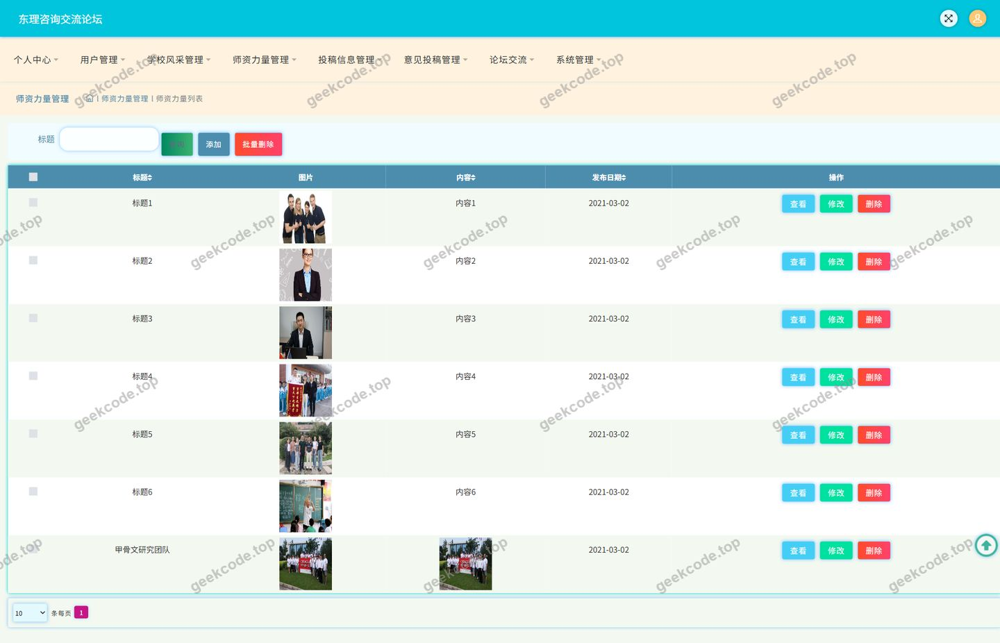
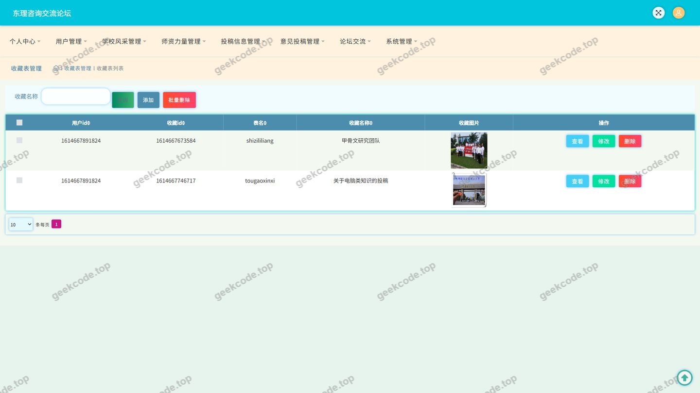
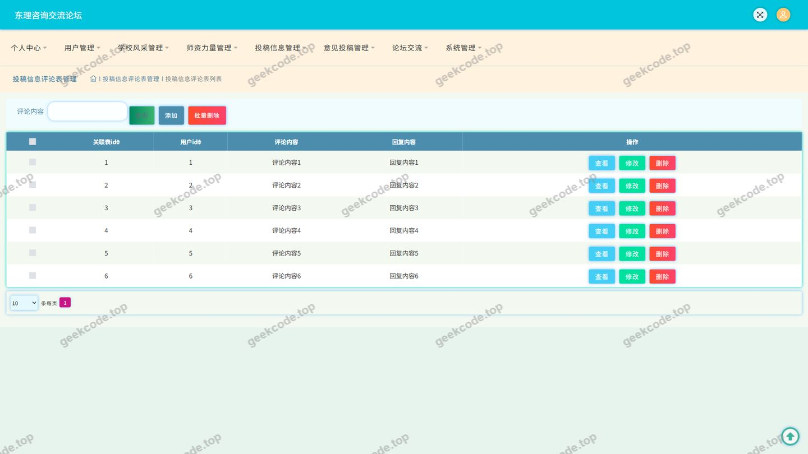
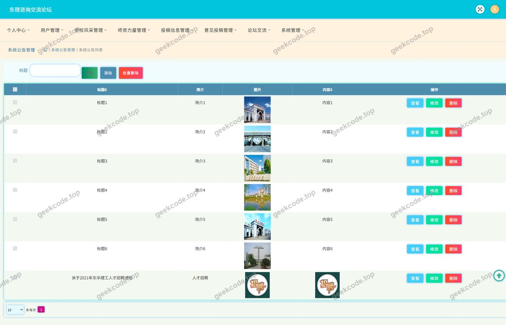
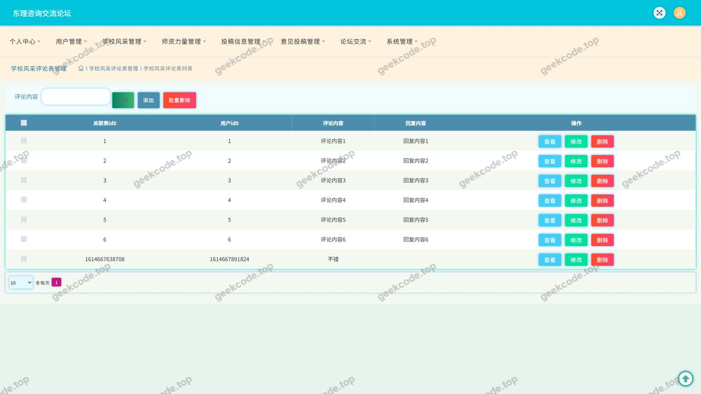
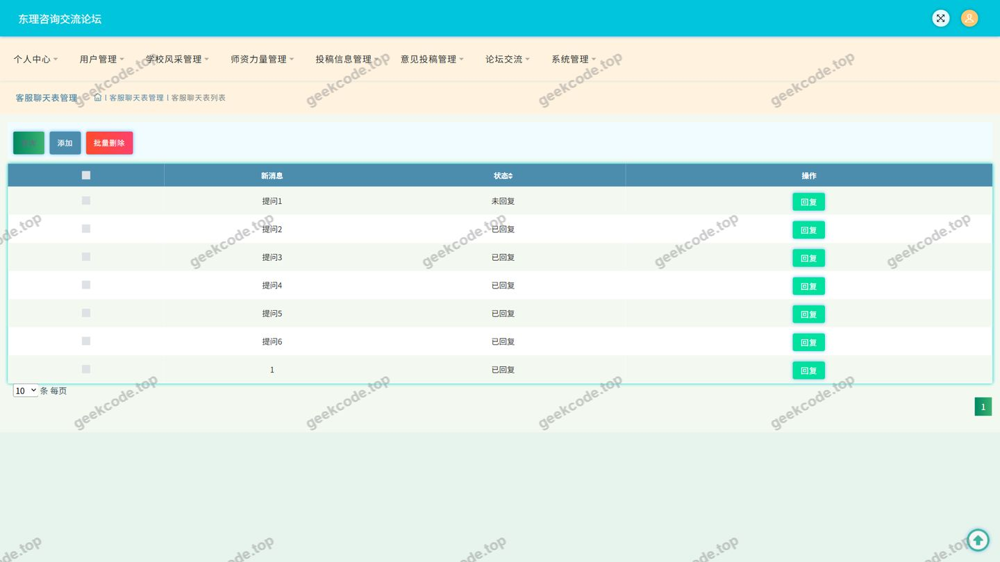

# ssm东理咨询交流论坛-java毕业设计

> 🎓 **计算机毕业设计 · ssm东理咨询交流论坛-java毕业设计**
>
> 本仓库只放**项目介绍 + 运行截图**（截图是站点带水印的原图，存在仓库 `images/` 里）。
>
> 👉 **完整可运行源码 / 数据库脚本 / 部署文档：[点我获取](https://geekcode.top/archives/ssm%E4%B8%9C%E7%90%86%E5%92%A8%E8%AF%A2%E4%BA%A4%E6%B5%81%E8%AE%BA%E5%9D%9B-java%E6%AF%95%E4%B8%9A%E8%AE%BE%E8%AE%A1?utm_source=github)**
>
> 💬 咨询微信：**ir9372**　|　🌐 更多项目：[极客代码 geekcode.top](https://geekcode.top/?utm_source=github)
>
> 📌 项目详情页：<https://geekcode.top/archives/ssm%E4%B8%9C%E7%90%86%E5%92%A8%E8%AF%A2%E4%BA%A4%E6%B5%81%E8%AE%BA%E5%9D%9B-java%E6%AF%95%E4%B8%9A%E8%AE%BE%E8%AE%A1?utm_source=github>

<table><td width="230" align="center"> <b>扫码加微信 ir9372</b></td><td valign="middle">📦 源码 = 项目介绍 + 全部运行截图 + 数据库 + 部署文档 👉 点上方任意截图，直接跳到 <b>极客代码 geekcode.top</b> 详情页</td></table>

---

<h1>ssm东理咨询交流论坛-java毕业设计</h1>
<h2>项目概述</h2>

东理咨询交流论坛是一个面向校园信息咨询与交流场景的 Java Web 后端项目（毕业设计）。项目围绕学校风采、师资力量、投稿信息、论坛交流、系统公告五大内容栏目，为用户提供信息浏览、内容评论、收藏、发布与在线交流能力，并通过个人中心、我的发布、我的收藏实现用户自助管理。系统以 pure-api 形态交付，后端不包含页面路由定义，由 Controller 统一对外暴露接口，供前端页面调用渲染。技术实现上采用 Spring + Spring MVC 的容器与 Web 层、MyBatis-Plus 作为持久层框架、Druid 作为数据源连接池，事务由 Spring 事务模块统一管理。适用人群包括在校师生、关注学校师资与投稿信息的咨询者，同时可作为 Java Web 方向毕业设计的技术实现参考。核心功能覆盖用户登录、多栏目内容管理、三类内容评论、收藏、论坛交流、系统公告与系统配置管理。

<h2>技术架构</h2>
<h3>整体架构</h3>

项目采用前后端分离的接口化架构。后端以 pure-api 形式组织，不存在前台路由与后台路由定义，页面层通过 HTTP 请求调用后端接口获取 JSON 数据并完成渲染与交互。后端内部遵循经典分层结构：Controller 层负责请求接收与参数校验，Service 层承载业务逻辑，Mapper 层基于 MyBatis-Plus 完成数据持久化，最终由 Druid 数据源连接 MySQL 数据库。

<h3>核心技术选型理由</h3>
<table>
<thead>
<tr>
<th>技术组件</th>
<th>作用</th>
<th>选型理由</th>
</tr>
</thead>
<tbody><tr>
<td>Spring Core / Context / Beans</td>
<td>IoC 容器与依赖注入</td>
<td>统一管理 Controller、Service 等 Bean 的生命周期与依赖关系</td>
</tr>
<tr>
<td>Spring MVC（spring-web、spring-webmvc）</td>
<td>Web 层请求分发</td>
<td>提供注解式控制器与请求映射，便于按业务模块拆分接口</td>
</tr>
<tr>
<td>spring-tx</td>
<td>事务管理</td>
<td>保证内容发布、评论、收藏等多表操作的数据一致性</td>
</tr>
<tr>
<td>spring-jdbc</td>
<td>JDBC 抽象支持</td>
<td>为持久层提供底层数据访问基础</td>
</tr>
<tr>
<td>MyBatis-Plus</td>
<td>持久层框架</td>
<td>简化单表 CRUD、条件构造与分页查询，降低样板代码量</td>
</tr>
<tr>
<td>Druid</td>
<td>数据源连接池</td>
<td>提供连接池管理与 SQL 执行监控能力</td>
</tr>
<tr>
<td>JUnit</td>
<td>单元测试</td>
<td>对核心业务逻辑进行测试验证</td>
</tr>
<tr>
<td>spring-context-support</td>
<td>上下文扩展支持</td>
<td>为缓存、任务等容器级能力提供支撑</td>
</tr>
</tbody></table>
<h3>数据库设计要点</h3>

从控制器划分可推断系统围绕以下核心数据实体进行建模：用户、学校风采、师资力量、投稿信息、论坛交流、系统公告、评论、收藏、聊天记录、文件、系统配置。

数据库设计上有三个明显特征：

<ol>
<li><strong>评论按业务对象独立建模</strong>。系统为学校风采评论（DiscusstougaoxinxiController 之外的 DiscussxuexiaofengcaiController）、师资力量评论（DiscussshizililiangController）、投稿信息评论（DiscusstougaoxinxiController）分别提供独立控制器，说明评论数据按所属内容类型分别建表存储，而非统一评论表，便于不同栏目的评论字段与审核规则独立演进。</li>
<li><strong>收藏为独立实体</strong>。StoreupController 单独承担收藏业务，收藏记录与被收藏对象分离，支撑跨栏目收藏与个人中心聚合展示。</li>
<li><strong>文件与配置抽离为公共服务</strong>。FileController 统一处理文件上传下载，ConfigController 统一管理系统配置项，避免各业务模块重复实现。</li>
</ol>

各数据表的具体字段名称、字段类型与索引设计，根据现有信息无法确定。

<h2>功能模块</h2>
<h3>前台用户端功能模块</h3>
<table>
<thead>
<tr>
<th>模块</th>
<th>对应控制器</th>
<th>功能描述</th>
</tr>
</thead>
<tbody><tr>
<td>登录认证</td>
<td>CommonController</td>
<td>提供用户登录、注册与会话相关接口</td>
</tr>
<tr>
<td>学校风采</td>
<td>DiscussxuexiaofengcaiController</td>
<td>学校风采内容的浏览，以及针对该内容发表评论</td>
</tr>
<tr>
<td>师资力量</td>
<td>ShizililiangController、DiscussshizililiangController</td>
<td>师资力量信息的浏览与评论</td>
</tr>
<tr>
<td>投稿信息</td>
<td>TougaoxinxiController、DiscusstougaoxinxiController</td>
<td>投稿信息的浏览、发布与评论</td>
</tr>
<tr>
<td>论坛交流</td>
<td>ForumController</td>
<td>论坛帖子浏览、发帖与主题交流</td>
</tr>
<tr>
<td>系统公告</td>
<td>NewsController</td>
<td>系统公告的浏览展示</td>
</tr>
<tr>
<td>在线交流</td>
<td>ChatController</td>
<td>用户之间的交流消息处理</td>
</tr>
<tr>
<td>收藏</td>
<td>StoreupController</td>
<td>内容收藏与取消收藏、我的收藏列表</td>
</tr>
<tr>
<td>文件处理</td>
<td>FileController</td>
<td>图片及附件等文件的上传与访问</td>
</tr>
<tr>
<td>个人中心</td>
<td>CommonController 等</td>
<td>个人资料维护，我的发布、我的收藏入口</td>
</tr>
</tbody></table>
<h3>后台管理端功能模块</h3>
<table>
<thead>
<tr>
<th>模块</th>
<th>对应控制器</th>
<th>功能描述</th>
</tr>
</thead>
<tbody><tr>
<td>用户管理</td>
<td>CommonController</td>
<td>用户账号的管理与维护</td>
</tr>
<tr>
<td>学校风采管理</td>
<td>DiscussxuexiaofengcaiController</td>
<td>学校风采内容的增删改查</td>
</tr>
<tr>
<td>师资力量管理</td>
<td>ShizililiangController、DiscussshizililiangController</td>
<td>师资力量信息与相关评论的管理</td>
</tr>
<tr>
<td>投稿信息管理</td>
<td>TougaoxinxiController、DiscusstougaoxinxiController</td>
<td>投稿信息与相关评论的审核与管理</td>
</tr>
<tr>
<td>论坛交流管理</td>
<td>ForumController</td>
<td>论坛帖子与交流内容的管理</td>
</tr>
<tr>
<td>系统公告管理</td>
<td>NewsController</td>
<td>公告的发布、修改与删除</td>
</tr>
<tr>
<td>收藏管理</td>
<td>StoreupController</td>
<td>收藏记录的查询与管理</td>
</tr>
<tr>
<td>系统配置管理</td>
<td>ConfigController</td>
<td>系统参数与配置项维护</td>
</tr>
<tr>
<td>文件管理</td>
<td>FileController</td>
<td>上传文件的管理与清理</td>
</tr>
</tbody></table>

项目本身未定义后台路由，上述管理端功能以接口形式提供，具体页面组织由前端实现，根据现有信息无法确定其页面结构与路由配置。

<h2>用户角色与权限</h2>

根据现有信息，系统涉及的用户角色划分如下：

<h3>普通用户</h3>
<ul>
<li>登录与注册：通过登录页面完成身份认证后进入系统。</li>
<li>内容浏览：可访问学校风采、师资力量、投稿信息、论坛交流、系统公告五大栏目内容。</li>
<li>内容发布：通过&quot;我的发布&quot;管理本人发布的内容，投稿信息与论坛交流支持发布操作。</li>
<li>内容评论：可对学校风采、师资力量、投稿信息发表评论。</li>
<li>内容收藏：可收藏关注的内容，并通过&quot;我的收藏&quot;查看收藏列表。</li>
<li>个人中心：维护个人信息，查看个人发布与收藏数据。</li>
<li>在线交流：通过聊天功能与其他用户交流。</li>
</ul>
<h3>系统管理员</h3>
<ul>
<li>用户管理：通过用户管理页面查看与维护用户账号。</li>
<li>内容管理：对学校风采、师资力量、投稿信息、论坛交流、系统公告进行发布、修改与删除。</li>
<li>评论管理：对学校风采评论、师资力量评论、投稿信息评论进行查看与管理。</li>
<li>收藏管理：查看与管理收藏记录。</li>
<li>系统配置管理：维护系统运行参数与配置项。</li>
<li>文件管理：管理系统上传文件资源。</li>
</ul>

现有信息中未出现教师、学生等更细粒度的角色定义，相关角色是否存在及其权限范围根据现有信息无法确定。

<h2>项目特色与创新点</h2>
<ol>
<li>
<strong>评论体系按内容类型独立设计</strong>。学校风采评论、师资力量评论、投稿信息评论分别建立独立控制器与数据模型，使不同栏目的评论结构、展示方式与管理策略可以独立调整，避免了通用评论表在字段扩展上的耦合问题。

</li>
<li>
<strong>信息咨询与交流双通道并行</strong>。系统在提供师资力量、投稿信息、学校风采等信息查阅能力的基础上，叠加论坛交流与在线聊天两种交流方式，既支持公开主题讨论，也支持用户间的直接沟通，形成完整的咨询交流闭环。

</li>
<li>
<strong>收藏能力独立且跨栏目复用</strong>。收藏功能通过独立的 StoreupController 实现，可对不同栏目的内容进行统一收藏并在个人中心聚合查看，提升用户对关注内容的持续追踪效率。

</li>
<li>
<strong>公共能力集中沉淀</strong>。文件处理与系统配置分别由 FileController、ConfigController 统一承担，各业务模块不重复实现文件上传与参数读取逻辑，降低系统维护成本。

</li>
<li>
<strong>接口化交付便于多端复用</strong>。项目以 pure-api 形式组织，后端仅对外暴露接口，页面层与后端解耦，便于后续扩展为多端应用。

</li>
</ol>
<h2>部署环境</h2>
<h3>服务端运行环境</h3>
<table>
<thead>
<tr>
<th>项目</th>
<th>要求</th>
</tr>
</thead>
<tbody><tr>
<td>JDK</td>
<td>需安装 JDK 并配置 JAVA_HOME，具体版本号根据现有信息无法确定</td>
</tr>
<tr>
<td>构建工具</td>
<td>Maven（项目依赖列表包含 junit、spring-core、spring-webmvc 等坐标，按 Maven 依赖形式组织）</td>
</tr>
<tr>
<td>Web 容器</td>
<td>项目使用 spring-webmvc 构建 Web 层，需部署到 Servlet 容器中运行；采用外置容器部署还是内嵌容器运行，根据现有信息无法确定</td>
</tr>
<tr>
<td>数据库</td>
<td>MySQL，需提前创建数据库并导入初始化数据</td>
</tr>
<tr>
<td>连接池</td>
<td>Druid，需在配置文件中配置数据库连接地址、账号、密码及连接池参数</td>
</tr>
</tbody></table>
<h3>依赖组件</h3>
<ul>
<li>spring-core、spring-beans、spring-context、spring-context-support</li>
<li>spring-aop、spring-tx、spring-jdbc</li>
<li>spring-web、spring-webmvc</li>
<li>MyBatis-Plus</li>
<li>Druid</li>
<li>JUnit</li>
</ul>
<h3>客户端环境</h3>

前端页面通过浏览器访问后端接口完成交互，需安装现代浏览器。项目依赖与上下文信息中未包含 Node.js 与微信开发者工具相关配置，是否需要这些工具根据现有信息无法确定。

<h2>五、技术特性</h2>
<ul>
<li>使用 MyBatis-Plus 简化数据访问层开发</li>
</ul>
<h2>六、功能模块截图</h2>
<h3>后台管理端</h3>
<h4>页面-登录</h4>

<h4>页面-论坛交流</h4>

<h4>页面-师资力量</h4>

<h4>页面-师资力量评论</h4>

<h4>页面-收藏</h4>

<h4>页面-投稿信息评论</h4>

<h4>页面-系统公告</h4>

<h4>页面-学校风采评论</h4>

<h4>页面-用户</h4>

---

## 获取完整源码

| 项目 | 说明 |
| --- | --- |
| 项目名 | ssm东理咨询交流论坛-java毕业设计 |
| 运行截图 | 本文 10 张（站点带水印原图，仓库 `images/` 目录） |
| 完整源码 | [https://geekcode.top/archives/ssm%E4%B8%9C%E7%90%86%E5%92%A8%E8%AF%A2%E4%BA%A4%E6%B5%81%E8%AE%BA%E5%9D%9B-java%E6%AF%95%E4%B8%9A%E8%AE%BE%E8%AE%A1?utm_source=github](https://geekcode.top/archives/ssm%E4%B8%9C%E7%90%86%E5%92%A8%E8%AF%A2%E4%BA%A4%E6%B5%81%E8%AE%BA%E5%9D%9B-java%E6%AF%95%E4%B8%9A%E8%AE%BE%E8%AE%A1?utm_source=github) |
| 咨询微信 | **ir9372**（备注：jingpin-yuanma） |
| 更多项目 | [极客代码 geekcode.top](https://geekcode.top/?utm_source=github) |

> 需要源码、部署、改配置、跑不起来等问题，加微信 ir9372 沟通，说明项目名即可。
